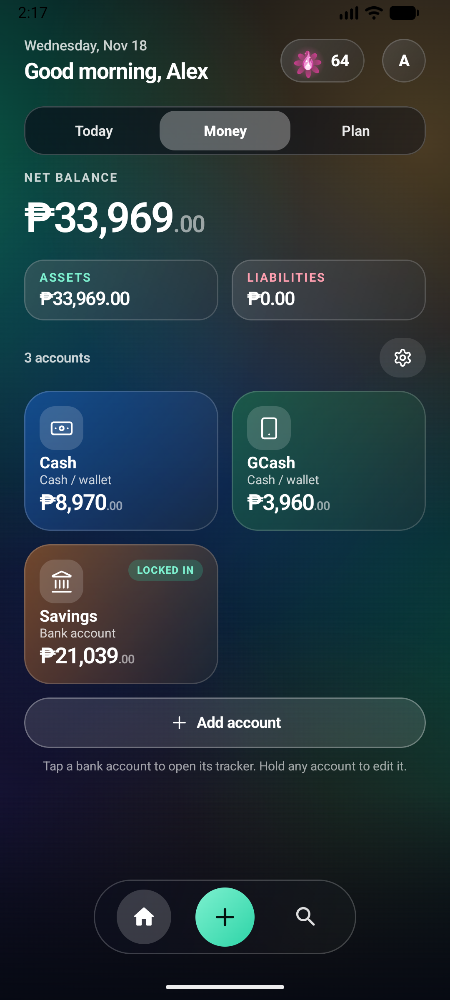
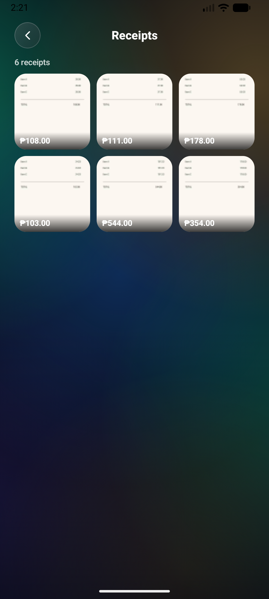
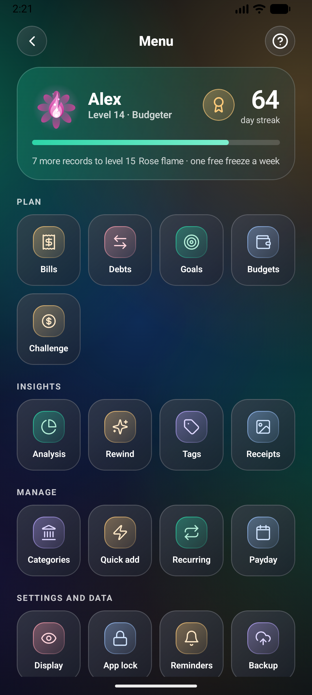

# MyWallet

**A private, offline money tracker for Android.**
No account. No ads. No cloud. Your money data never leaves your phone.

  

---

## What is MyWallet?

MyWallet is a personal money tracker built for people who want to know where their money goes without handing their data to anyone. It is a fully native Android app (Kotlin + Jetpack Compose) with a glass-style look, a soft animated background and a floating dock.

It was built first for students living on an allowance and a bank account with a **minimum balance**, so that part is a first-class feature, not an afterthought.

## Screenshots

| Today | Money | Plan |
|:---:|:---:|:---:|
|  |  |  |

| Analysis | Bank tracker | Badges and level |
|:---:|:---:|:---:|
|  |  |  |

| Monthly Rewind | Receipts | Menu |
|:---:|:---:|:---:|
|  |  |  |

## Features

### Everyday tracking
- Add expenses, income and transfers in a few taps
- **Quick add** favourites for the things you log every day
- Multiple accounts (cash, e-wallet, bank), each can be edited, hidden or removed
- Custom categories with icons, tags and notes
- Recurring records that add themselves
- Search across everything
- Split a bill between people

### Bank minimum-balance tracker
- Set the bank's rule (minimum balance, fee, how it is measured)
- See your **Safe to spend** amount so you never drop below the limit
- Tracks interest and other fees

### Plan ahead
- Bills with due dates, debts, savings goals
- Monthly budgets per category with spending alerts
- Savings challenges
- Payday screen

### Insights
- Analysis with spending breakdowns and trends
- **Monthly Rewind**: your month as animated story slides
- Receipts gallery with a full-size viewer
- Monthly statement as a PDF

### Keep it fun
- Streak flames that grow from your first day up to 365 days
- Endless levels with 10 titles
- 14 badges to unlock

### Private and secure
- Everything is stored on your phone, nothing is uploaded
- Data file and receipt photos are encrypted with the Android Keystore
- App lock with a passcode (salted, with a wait after wrong tries)
- Optional screenshot and app-preview blocking
- Hide amounts with one tap

### Your data, your control
- Backup and restore with compressed `.mwbackup` files, optionally password protected
- CSV export, share and import
- Backup reminder
- Delete all your data at any time

### Gentle reminders
- One switch, a few random nudges a day
- No amounts are ever shown in notifications

## Install

1. Open the [**Releases**](../../releases) page.
2. Download the latest `MyWallet-vx.x.x.apk`.
3. Open it on your phone. If asked, allow installs from your browser or file manager.

Requires Android 7.0 (API 24) or newer.

## Build it yourself

1. Install the latest Android Studio.
2. Clone this repository and open it as a project.
3. Let Gradle sync, then press **Run** or use **Build > Generate Signed Bundle / APK** for a release build.

Release builds are signed with a private keystore that is not part of this repository.

## Built with

- Kotlin and Jetpack Compose
- kotlinx.serialization
- Haze (glass blur effects)
- AndroidX Biometric
- ML Kit text recognition

## Privacy

MyWallet has no servers, no analytics and no account system. It asks for no network access to read your data. Your records live only in the app's private storage on your phone and in the backup files you choose to make.

## License

Personal project by [Danyell-bot](https://github.com/Danyell-bot). All rights reserved unless a license file says otherwise.
