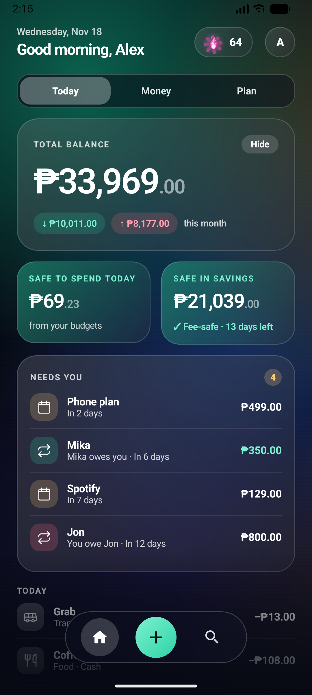
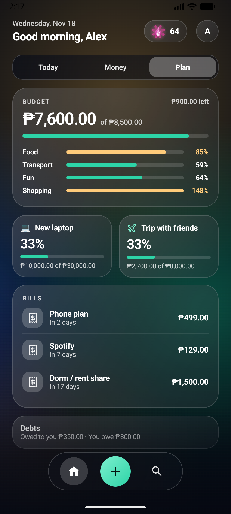
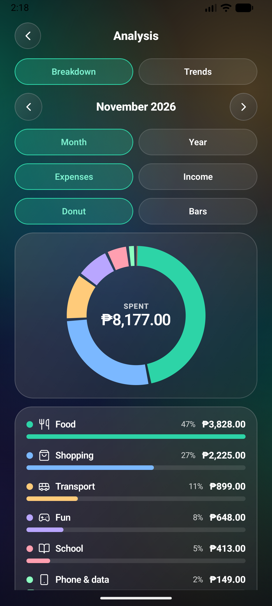
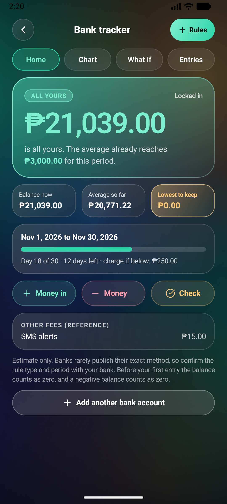
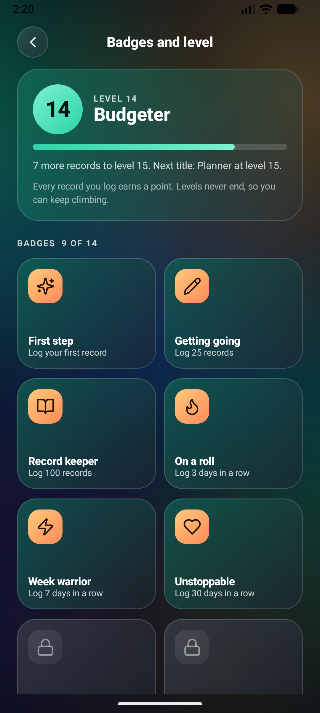
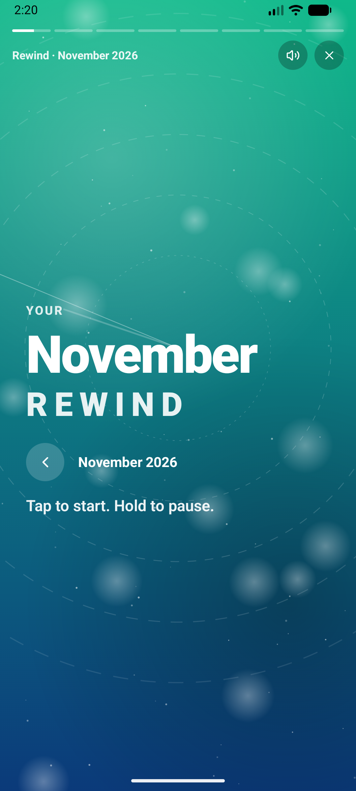

# MyWallet

Private, offline money tracker for Android.

  

---

## About

Native Android app (Kotlin, Jetpack Compose) for tracking expenses, income and transfers. No account, no ads, no network. Data stays on the device.

Built around bank accounts with a minimum balance.

## Features

- Expenses, income, transfers, multiple accounts, categories and tags
- Quick add, recurring records, split bills
- Bank minimum-balance tracking with a safe-to-spend amount
- Bills, debts, savings goals, budgets
- Receipt photos with on-device total scanning
- Analysis, monthly Rewind, PDF statements
- Streaks, levels, badges
- Themes and color palettes
- Backup and restore, CSV import and export
- App lock, hidden amounts

## Screenshots

| Analysis | Bank tracker | Badges |
|:---:|:---:|:---:|
|  |  |  |

| Rewind | Receipts | Menu |
|:---:|:---:|:---:|
|  |  |  |

## Install

Download the latest APK from [Releases](../../releases) and open it on your phone. Requires Android 7.0 or newer. Play Protect may ask to scan the app.

## Build

Open in Android Studio, sync Gradle, then Run or Build > Generate Signed Bundle / APK. Release builds use a private keystore that is not in this repo.

## Built with

Kotlin, Jetpack Compose, kotlinx.serialization, Haze, AndroidX Biometric, ML Kit.

Fonts: Fredoka and Pixelify Sans (SIL OFL 1.1).

## License

All rights reserved unless a license file says otherwise.
